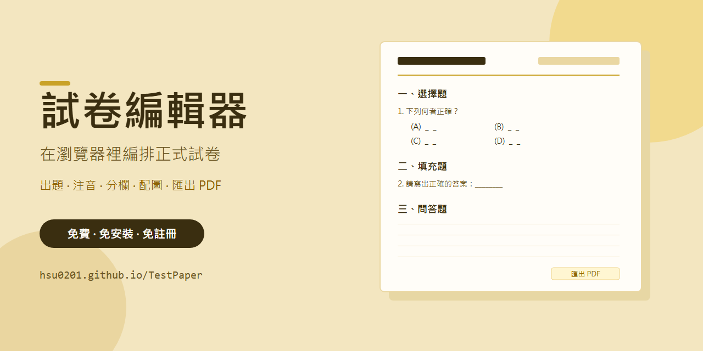
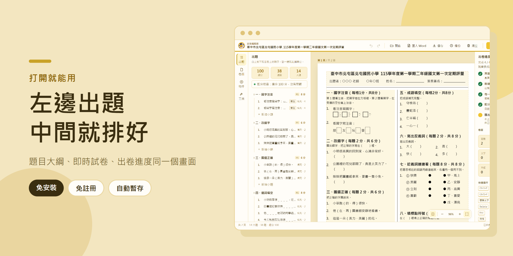
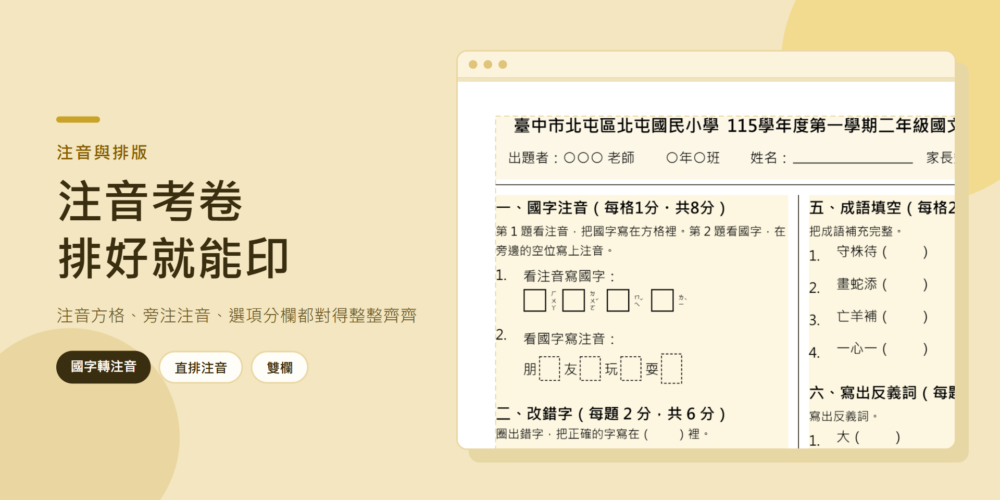
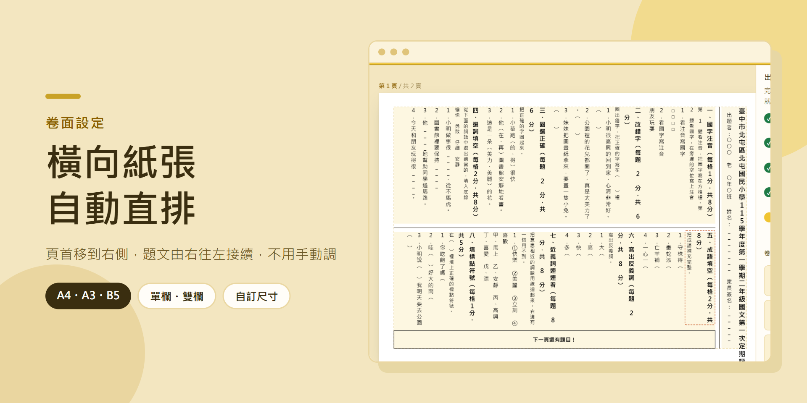
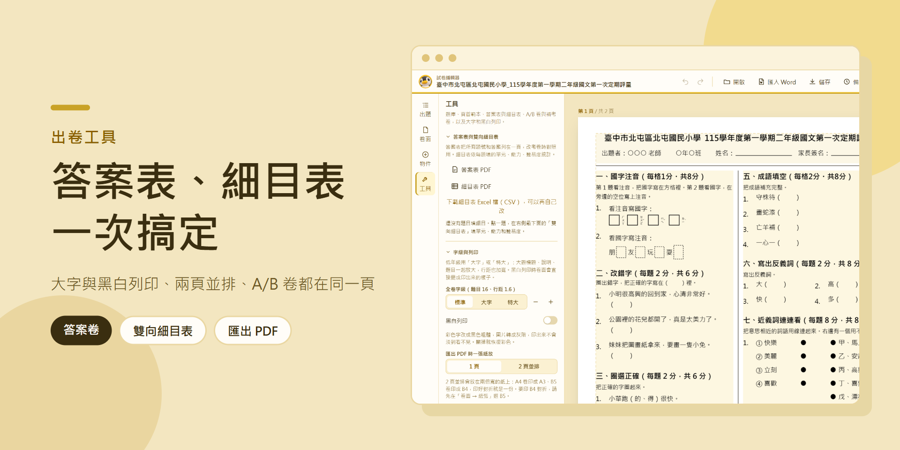
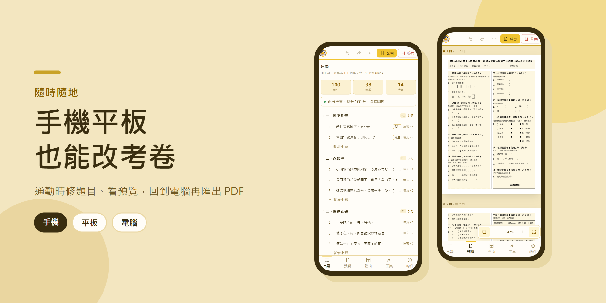

# TestPaper — Exam Paper Editor

[繁體中文](README.md) | **English**

[](https://github.com/HSU0201/TestPaper/stargazers)
[](https://github.com/HSU0201/TestPaper/network/members)
[](LICENSE)

**👉 [Try it online](https://hsu0201.github.io/TestPaper/)**: runs entirely in the browser. No install, no sign-up, and your data never leaves your computer.

A browser-based editor for teachers to lay out formal, print-ready exam papers. Arrange the header, sections and questions the way your school formats its tests, set question types, scores, Zhuyin (Bopomofo) and instructions, then export a printable PDF or save the whole paper as JSON.

It was built for elementary-school teachers in Taiwan, so the interface is in Traditional Chinese and it supports things general-purpose word processors handle poorly: Zhuyin annotations, vertical (top-to-bottom, right-to-left) layout on landscape paper, and Chinese section numbering.

## Screenshots











## Why

A formal exam needs a fixed page: header fields, Chinese section numbers, options in columns, figures attached to questions, Zhuyin, and line spacing that still lines up after you change the paper size. A word processor mixes all of this into one stream of text, so changing the column count or page orientation scatters the numbering and images.

This editor keeps **content** and **layout** apart. Questions define structure; the sheet settings define header, paper, columns and type sizes. A flow-layout engine recomputes every page from those, while free-floating objects stay pinned to their page.

## Features

- **Question types**: single choice, multiple choice, fill-in-the-blank, and open-ended. Options in 1, 2 or 4 columns; images below, beside, inline, or after the options; ruled answer lines.
- **Sections**: drag to reorder, continuous or per-section numbering, vertical arithmetic tables, side-by-side questions, per-blank scoring and an automatic score check.
- **Zhuyin (Bopomofo)**: convert characters to Zhuyin, or add vertical Zhuyin to the right of each character, with a bundled Zhuyin font. Polyphonic characters can be picked by hand.
- **Paper**: A4, A3, B5, Letter or custom size; portrait or landscape (landscape switches to vertical text); single or two columns; adjustable spacing that compresses automatically when a page is nearly full.
- **Header**: school, subject, class, seat number, name, date, time limit, total score, author, parent signature, or custom fields.
- **Objects**: free text, lines, boxes and images pinned to a page, with snapping guides.
- **Tools**: answer-key PDF, test blueprint (PDF / CSV), large-print mode, black-and-white print, 2-up printing, and an A/B version generator.
- **Import existing exams**: turn a Word (`.docx`), PDF or photographed exam into editable sections and questions, optionally pulling answers from a separate answer document. PDFs are read from their text layer; scanned PDFs and photos go through in-browser OCR (Tesseract.js), so files never leave the computer.
- **Saving**: auto-saves to IndexedDB about one second after each edit, keeps a rolling backup every 3 minutes (up to 15), and exports/imports JSON.
- **PDF export**: pages are rendered straight from the canvas in the browser. Nothing is uploaded to a server.

## Getting started

Teachers can simply open the **[online version](https://hsu0201.github.io/TestPaper/)**. To run it locally:

Requires [Node.js](https://nodejs.org/) 20 or later.

```bash
npm install
npm run dev
```

Then open the URL shown in the terminal (default `http://localhost`). The first launch loads a sample exam with Zhuyin, options, a vertical table and images.

```bash
npm run build      # type-check and build to dist/
npm run preview    # preview the production build
npm run lint       # ESLint
npm test           # Vitest
```

`npm run build` outputs static files that can be hosted anywhere. Every push to `main` is linted, tested and deployed to GitHub Pages by GitHub Actions.

## Tech stack

React 19, TypeScript and Vite. Pages are drawn with [Konva](https://konvajs.org/) (react-konva), PDFs are produced by [jsPDF](https://github.com/parallax/jsPDF) from the page canvases, and Zhuyin readings come from [pinyin-pro](https://github.com/zh-lx/pinyin-pro).

```
src/
  components/   UI (top bar, side panels, paper, inspector)
  editor/       state, undo, flow layout, Zhuyin, persistence
  export/       PDF
  fonts/        paper fonts and the Zhuyin font
  import/       Word, PDF and photo (OCR) import
  types/        questions, layout, canvas objects
```

## Contributing

Issues and pull requests are welcome. Please run `npm run lint` and `npm test` before opening a PR.

## License

[MIT](LICENSE) © 2026 徐生 (Hsu)

## Author

[徐生 (HSU0201)](https://github.com/HSU0201)
